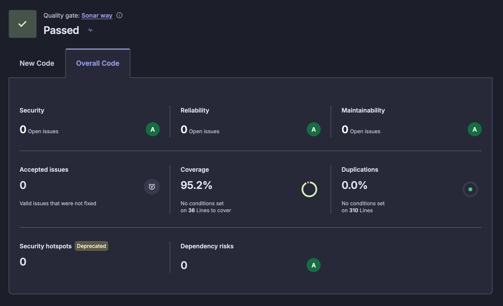
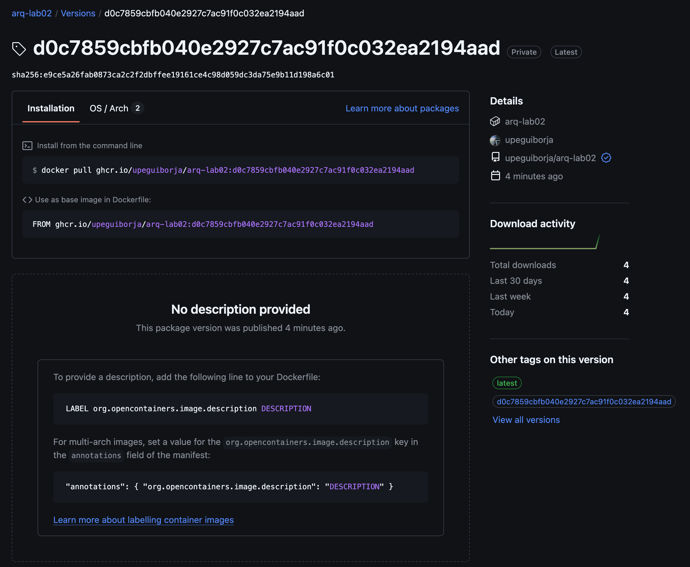
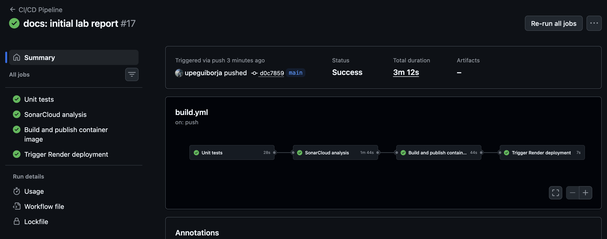
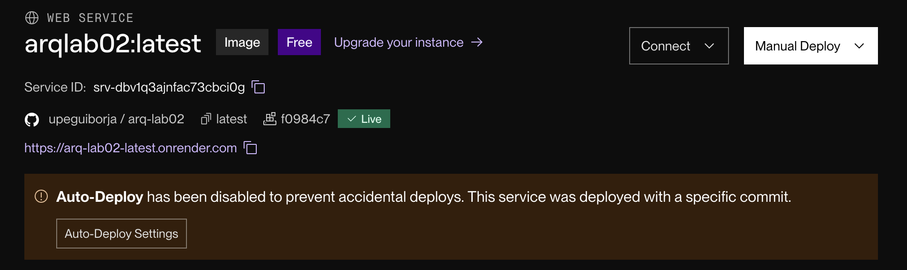
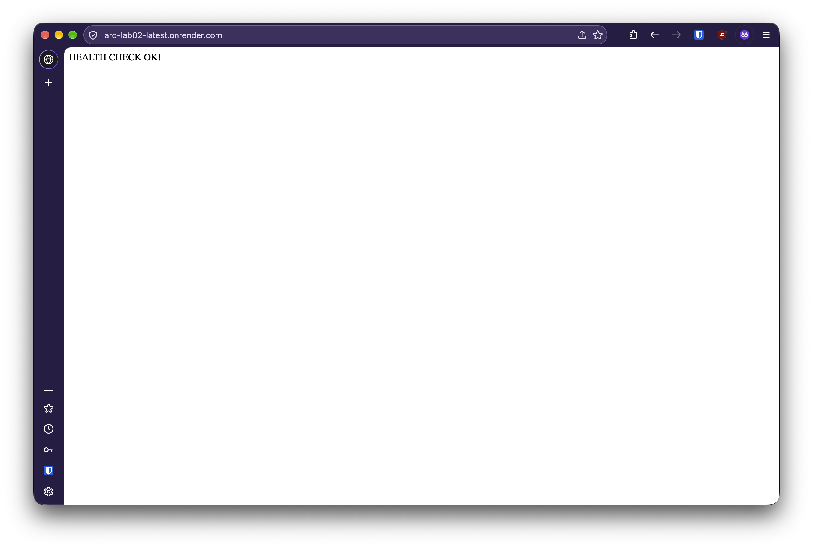
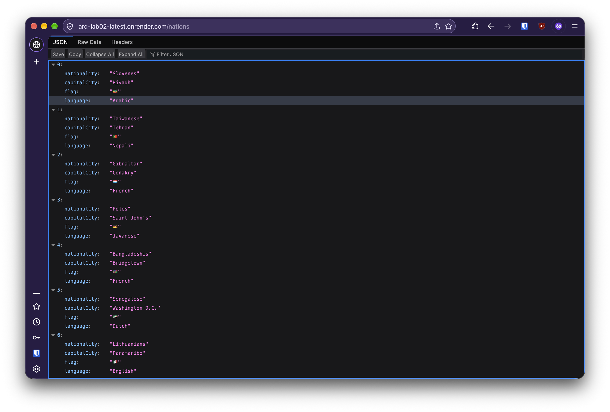

# Laboratorio 2 – Integración y despliegue continuo de una API Spring Boot

 

**Curso** · Arquitectura de Software 
**Programa** · Ingeniería de Sistemas, Universidad de Antioquia 
**Autor** · Mateo Upegui Borja <[mateo.upeguib@udea.edu.co](mailto:mateo.upeguib@udea.edu.co)>.

## 1. Introducción

En este informe detallaremos el proceso para configurar un pipeline de despliegue e integración continua o CI/CD del inglés continuous integration y continuous deployment, para ello desarrollamos una API de ejemplo que genera datos de sobre países, monedas y datos relacionados con la aviación de manera aleatoria. Una vez contemos con este proyecto configuramos nuestro pipeline de GitHub actions para que ejecute las pruebas unitarias del proyecto, haga análisis estático de código utilizando SonarCloud para luego construir un contenedor de Docker que publicaremos en Github Packages y ejecutaremos en Render. 

## 2. Objetivos

- Demostrar la automatización de pruebas unitarias y el análisis de calidad del código mediante estrategias DevOps.
- Demostrar la automatización de la publicación de los artefactos, en este caso contenedores, y su despliegue de manera continua.
- Analizar la utilidad y beneficios del aseguramiento continuo de la calidad del código mediante análisis estático.

## 3. Herramientas y requisitos

| Componente | Función |
| --- | --- |
| Java 21, Maven y JaCoCo | Compilar la API, ejecutar las pruebas y generar el informe de cobertura. |
| GitHub Actions | Orquestar las tareas del pipeline.|
| SonarQube Cloud | Ejecutar el análisis estático del código. |
| Docker y GitHub Container Registry (GHCR) | Construir, etiquetar y distribuir la imagen. |
| Render | Ejecutar el contenedor y consultar la API por HTTPS. |

## 4. Configuración del pipeline

### 4.1. Backend local

Una vez hemos clonado el repositorio podemos iniciar ejecutando las pruebas unitarias y empaquetando nuestra aplicación utilizando Maven de manera local, para ello ejecutamos el comando `./mvnw clean verify` con Java 21. De esta manera Maven ejecutará las pruebas unitarias, generará el paquete `target/lab2.jar` y escribirá el informe de cobertura de las pruebas en el directorio `target/site/jacoco/`. Seguidamente, para probar el artefacto empaquetado localmente dentro de su contenedor, ejecutamos el comando `docker build -t arq-lab02 .` y luego `docker run --rm -p 8080:8080 arq-lab02`. De esta manera, Docker utilizará nuestro Dockerfile iniciando en la etapa de compilación con la imagen de contenedor `maven` para nuevamente compilar y empaquetar el proyecto, y luego, terminará copiando el paquete a un contenedor base con JRE 21. 
- [Configuración de Maven](pom.xml)
- [Dockerfile](Dockerfile)

### 4.2. SonarQube Cloud con GitHub Actions

Una vez nuestro proyecto funciona correctamente, creamos un proyecto manual en SonarQube Cloud y seleccionamos el análisis mediante GitHub Actions. Aqui seleccionaremos organización el identificador de proyecto que creamos anteriormente. Luego generamos un token con permiso de análisis y lo guadamos como `SONAR_TOKEN` utilizando Github (**Settings → Secrets and variables → Actions** del repositorio) .

Nuestro pipeline de CI/CD ejecuta `mvn -B test` en primer lugar. Si estas pruebas se ejecutan correctamente, el segundo paso ejecuta `mvn -B clean verify` y envía el análisis a Sonar Cloud. El estado de las métricas de sonar como el *quality gate* se consulta en las insignia en la parte superior de este informe.
- [Flujo de GitHub Actions](.github/workflows/build.yml)

### 4.3. Image Registry (GHCR)

Nuestro pipeline de CI/CD está configurado de tal manera que al integrar nuevos cambios a la rama `main` se ejecutarán las etapas anteriores, si finalizan correctamente el pipeline lanzará una nueva tarea para publicar la imagen del contenedor a Github Packages, que es la alternativa que ofrece GitHub a Docker Hub, para ello el pipeline solicita credenciales a GitHub con permisos para escribir paquetes `packages: write`, luego inicia sesión en `ghcr.io` con el token temporal de GitHub suministrado anteriormente y finalmente publica la imagen con dos etiquetas. La etiqueta `latest` y la etiqueta con el SHA completo del último commit integrado a la rama.

### 4.4. Crear el servicio en Render y activar el despliegue

1. Después de la primera publicación, debemos crear un **Web Service → Existing Image** en Render utilizando `ghcr.io/upeguiborja/arq-lab02:latest` como nuestra imagen de contenedor pre-existente. Ya que el paquete es privado, tambien debemos registrar una credencial de Github (Un Personal Access Token) con permiso de lectura de paquetes (`packages:read`).
2. Seguidamente debemos configurar la ruta de healthcheck `/` y crear el servicio. Nuestra aplicación escuchará por defecto en el puerto 8080.
3. Luego copiamos la **Deploy Hook URL** desde los ajustes del servicio en render, para lanzar este webhook dentro de nuestro pipeline. Al contener un token que debe ser secreto la almacenamos en GitHub Actions como un secreto del repositorio con el nombre `RENDER_DEPLOY_HOOK_URL`.
4. En el siguiente push a `main`, la última tarea de nuestro pipeline invoca el hook con la imagen etiquetada con el SHA. Si observamos dentro de Render en la pestaña **Events** podremos comprobar que el despliegue correspondiente llega al estado **Live**. 

- [Despliegue desde un registro](https://render.com/docs/deploying-an-image)
- [Deploy hooks de Render](https://render.com/docs/deploy-hooks)

## 5. Evidencia de ejecución en la nube

Finalmente para comprobar que nuestra aplicación se desplegó correctamente hacemos llamadas HTTP desde nuestro navegador para comprobar que cada uno de los endpoints devuelve el valor correcto.

## 6. Conclusiones

- Con GitHub Actions logramos que cada cambio integrado a la rama `main` tuviera que pasar por las mismas verificaciones. Primero se ejecutan las pruebas unitarias con Maven y, si estas pasan, se envía el análisis estático de código a SonarQube Cloud. De esta manera pudimos consultar en una misma ejecución qué pruebas pasaron y en qué etapa se presentó un error.

- Una vez completadas estas etapas, nuestro pipeline construyó correctamente la imagen de contenedor Docker, esta fue publicada en GitHub Packages y finalmente nuestro pipelina solicitó su despliegue en Render. Al utilizar el SHA del commit como etiqueta podemos identificar qué versión de nuestro código se está ejecutando Render. Finalmente, con las consultas desde el navegador comprobamos que la API desplegada respondía al healthcheck y devolvía la versión y los datos de países esperados.

- El análisis estático complementa las pruebas unitarias. Mientras las pruebas nos permiten comprobar que los endpoints responden como esperamos, SonarQube Cloud nos ayuda a identificar código duplicado y posibles problemas de mantenimiento. Al repetir el análisis con cada cambio podemos comparar sus resultados con los de la versión anterior y corregir un problema mientras todavía tenemos presente el código que lo introdujo.
